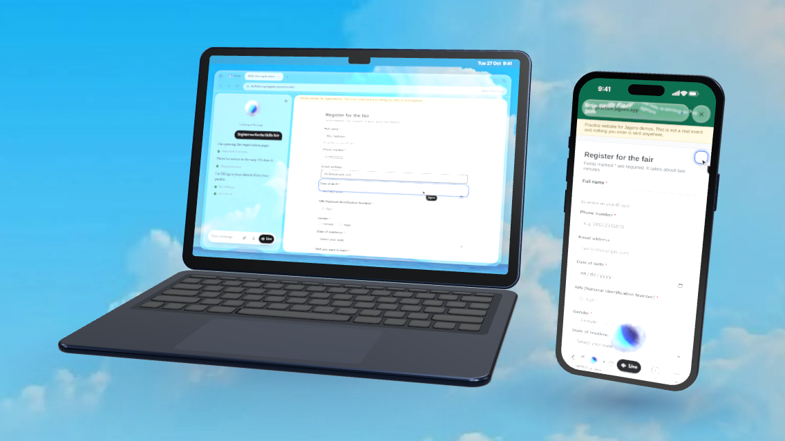
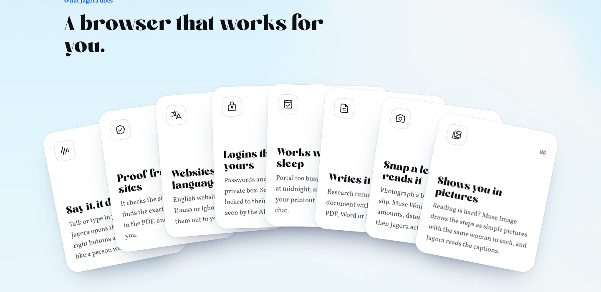
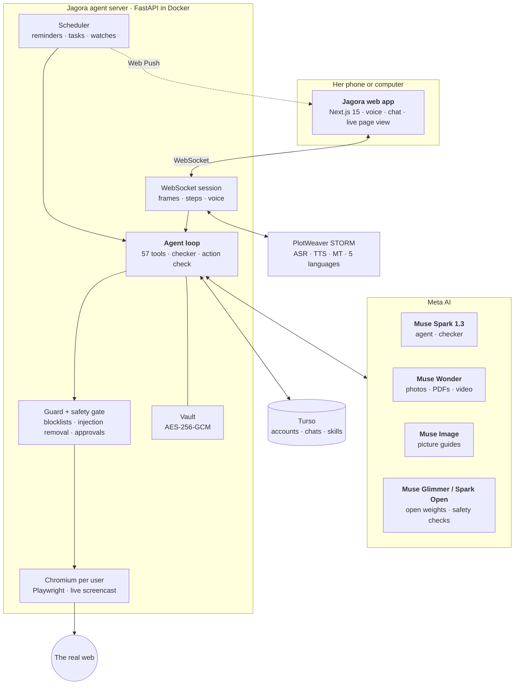
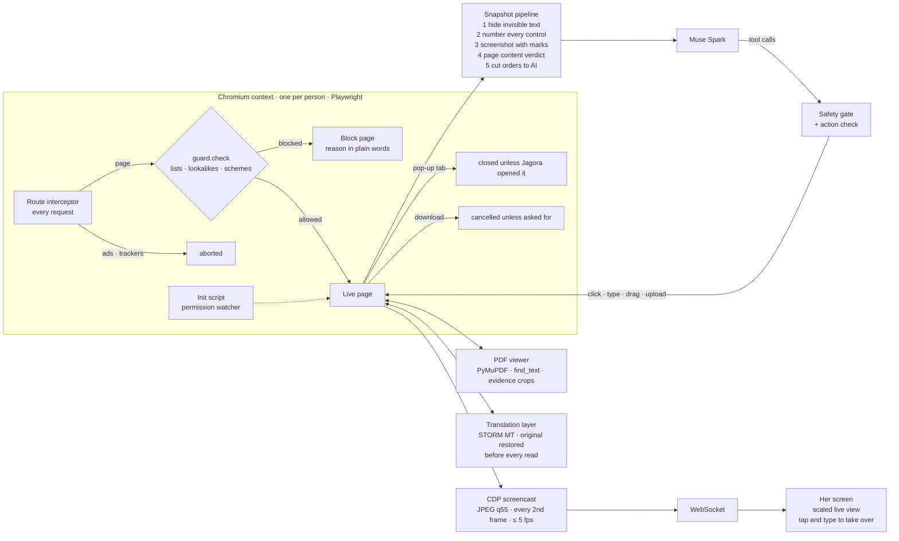
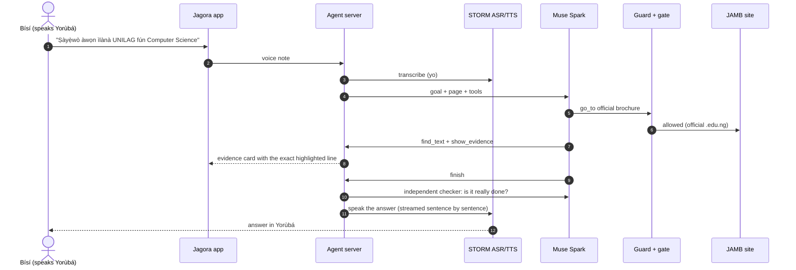

<p align="center">
  
</p>

<h3 align="center">The internet, in your own words.</h3>

<p align="center">
  A voice-first agentic browser for Nigeria. Speak Yorùbá, Hausa, Igbo, Nigerian Pidgin or English,<br>
  and Jagora uses real websites for you: it searches, reads, proves, fills, pays and schedules, and stops for your yes.
</p>

<p align="center">
  <a href="https://jagora-ai.vercel.app"><b>Open Jagora</b></a> ·
  <a href="#how-meta-ai-powers-jagora">Meta AI inside</a> ·
  <a href="#architecture">Architecture</a> ·
  <a href="#safety-model">Safety</a> ·
  <a href="#run-it-yourself">Run it</a>
</p>

<p align="center">
  
  
  
  
  
  
</p>

---

<p align="center">
  
</p>

## Contents

1. [Why Jagora](#why-jagora)
2. [What it does](#what-it-does)
3. [How Meta AI powers Jagora](#how-meta-ai-powers-jagora)
4. [Architecture](#architecture)
5. [A task, step by step](#a-task-step-by-step)
6. [Safety model](#safety-model)
7. [Voice and languages](#voice-and-languages)
8. [Run it yourself](#run-it-yourself)
9. [Tests and the attack range](#tests-and-the-attack-range)
10. [Repository map](#repository-map)
11. [Privacy](#privacy)
12. [Credits](#credits)
13. [License](#license)

---

## Why Jagora

Much of daily life in Nigeria now runs through websites: JAMB registration and results, WAEC checks, NIN and
passport services, electricity tokens, train tickets, bank and government portals. Those sites assume you read
English comfortably, type quickly, and can tell the real portal from a copy.

Millions of people think and speak in Yorùbá, Hausa, Igbo or Pidgin first. Today they pay a café attendant, ask a
relative, give up, or fall for a fake "JAMB upgrade" site.

Jagora closes that gap. It listens in the language you think in, does the work on the real website, shows proof
from official sources, and asks before anything that matters.

## What it does

<p align="center"></p>

| | Capability | In practice |
|---|---|---|
| 🗣️ | **Say it, it does it** | "Forúkọ mi sílẹ̀ fún Skills Fair" and Jagora opens the site, fills the form from your saved details, and asks before submitting. |
| 🔎 | **Proof from official sources** | Checks the site is the real one, finds the exact line in the page or PDF, and highlights it as evidence. |
| 📷 | **Snap a letter, it reads it** | A photo, PDF or short video of a bill, letter or result slip becomes facts, deadlines and scam signs (Muse Wonder). |
| 🖼️ | **Shows you in pictures** | For people who find reading hard, the steps become a short picture guide with the same character in every frame (Muse Image). |
| 🌍 | **Websites in your language** | English pages are shown in Yorùbá, Hausa or Igbo while the agent still reads the original. |
| 🔐 | **Logins that stay yours** | Passwords, PINs, OTPs, NIN and BVN go through a private box the model never sees. Saved logins are sealed (AES-256-GCM) and bound to their own site. |
| 🌙 | **Works while you sleep** | "Try JAMB at midnight and keep checking until the portal is up": scheduled tasks with retries, results on your lock screen. |
| 📄 | **Writes it up** | Research turns into a document with sources, as PDF, Word or Markdown. |
| 🔗 | **Link checker** | Unmasks shorteners, redirect chains, IP loggers and tracking codes before anyone opens a link. |
| 📜 | **Reads the terms for you** | Before you sign up or pay, the site's terms and privacy policy are reviewed in the background and red flags are said aloud. |
| 🧠 | **Gets better at each site** | Steps that worked on a site are remembered (page words only, never personal values) and guide the next run. |

## How Meta AI powers Jagora

Jagora uses four parts of Meta's model family, each for the job it does best.

| Meta model | Role in Jagora | Where in the code |
|---|---|---|
| **Muse Spark 1.3**<br>`muse-spark-1.3` | The agent's brain. One tool-calling loop over 50+ tools (search, open, click, type, upload, drag, read PDFs, show evidence, schedule, remember). Sees the page as a numbered element list plus a screenshot. Also runs the **completion checker** (a second call that must agree the task is done before the user hears "done"). | `backend/jagora/agent.py`, `llm.py` |
| **Muse Wonder**<br>`muse-wonder-1.0` | Reads what she shares in one call: photos, screenshots, PDFs (as page images) and short videos (as stills). Returns sender, amounts, reference numbers, deadlines, what it asks her to do, and scam risk, in her language. Jagora then acts on it. | `backend/jagora/muse.py` (`read_attachment`) |
| **Muse Image**<br>`muse-image-1.0` | Picture guides. A result becomes 3 or 4 illustrations: the first is generated from a fixed character and style, the rest are drawn from it with `images/edits`, so the same woman appears in every frame. Captions are read aloud. | `backend/jagora/muse.py` (`Images`, `draw_guide`) |
| **Muse Glimmer / Muse Spark Open**<br>open weights | When `OPEN_BASE_URL` points at an OpenAI-compatible server (vLLM, SGLang, llama.cpp or a hosted provider), the **safety judgement** (the separate "does this action match her request?" check) and the **terms review** run on the open model, on hardware we control. Without it, Muse Spark does that work. | `backend/jagora/muse.py` (`open_model`) |

Why not Muse Voice Transcribe for speech? Its 25 evaluated languages do not include Yorùbá, Hausa, Igbo or
Pidgin, so speech goes through PlotWeaver's STORM models, which were trained for exactly these languages (see
[Voice and languages](#voice-and-languages)).

**How the calls are shaped**

- **Thinking budget per call.** `reasoning_effort` is `low` for agent steps and checks. If all tokens go to
  thinking, the call is retried with more room.
- **Context that stays small.** Only the newest page is sent in full. Older results are shortened, and the
  system prompt is stable so it can be cached.
- **Separate judges.** The completion checker and the action check never see the agent's reasoning, only the
  evidence and her words.

## Architecture

<p align="center"></p>

<details>
<summary>Same diagram as text (Mermaid)</summary>



</details>

### Inside the browser

<p align="center"></p>

Jagora drives a real Chromium for each person (phone layout on phones, desktop layout on computers). This is
what happens around it:



| Piece | How it works |
|---|---|
| **Snapshot** | `snapshot.js` runs in the page. It numbers every control a person could use, skips anything covered by a pop-up (an occlusion check at each control's centre point), and reads each control's label the way a person would (label, nearby text, placeholder, group legend). The model sees the numbered list plus a marked screenshot. |
| **Acting** | Clicks fall back step by step: a normal click, then a forced check for styled checkboxes and radios, then a script click. Clicks that jump to an unexpected site are checked by the guard and undone when needed. Typed values are read back and converted by code, so phone numbers, dates and names spoken in five languages come out right. |
| **Seeing it live** | Chrome DevTools Protocol screencast frames go to her app, which overlays them at the right scale. She can tap and type on the live page to take over at any moment. |
| **PDFs** | Opened in a built-in viewer (PyMuPDF), searched page by page, and cropped as highlighted evidence. |
| **Translation** | Pages are shown in her language, and the original is restored before every read, so the agent never reasons over a translation. |


| Layer | Technology |
|---|---|
| App | Next.js 15, React 19, Tailwind v4, Motion, Zustand, WebGL (living orb, cloud-glass wordmark), three.js (3D devices) |
| Server | Python 3.12, FastAPI, WebSockets, Playwright Chromium, PyMuPDF, ffmpeg |
| Models | Meta Model API (Muse Spark, Muse Wonder, Muse Image), optional open weights, PlotWeaver STORM speech |
| Data | Turso (libSQL over HTTP), SQLite fallback, per-site encrypted vault |
| Safety | Public blocklists (StevenBlack, URLhaus, Phishing.Database, HaGeZi), lookalike detection, content classifiers |
| Delivery | Vercel (app), Docker behind Caddy on AWS EC2 (agent), Web Push (VAPID) |

## A task, step by step



## Safety model

<p align="center"></p>

People can visit any site themselves. Jagora is the thing that **acts**, so it has to be safe to hand the keys to.
Every rule below is enforced in code, outside the model, so no web page or prompt can talk it out of them.

| Layer | What it stops | Code |
|---|---|---|
| **Site guard** | Phishing and malware, adult sites, lookalike domains (typosquats and brand words), **betting** (even when called "trading" or "a game"), **exam fraud** ("expo", "runz", score upgrades), **money-doubling schemes**, fake documents, hacking services, drugs and weapons, pirated downloads, **IP-logger links** | `guard.py` |
| **Page content check** | The same categories on sites no list knows yet, judged by what the page itself says | `guard.py` (`page_verdict`) |
| **Prompt-injection defence** | Text hidden from people (white-on-white, off-screen, tiny, clipped) is removed before reading, and text written to give orders to AI assistants is cut out and flagged | `guard.py` (`HIDE_TRAPS_JS`, `defang`) |
| **Action check** | Before anything that commits, a separate model call checks the action against **her** request, which catches a model talked into paying, posting or sending data elsewhere | `agent.py` (`_fits_request`) |
| **Approval gate** | Submit, pay, send, agree and leave-the-site all wait for her yes. Spoken numbers are read back before typing. | `safety.py` |
| **Her account's locks** | Changing passwords, turning off two-step login, changing recovery details, deleting accounts and adding new money recipients are hers to do (Take over), never Jagora's | `safety.py` (`HER_LOCKS`) |
| **Task sites** | Each task gets a short list of sites it may act on: sites she named, official sites, and sites she allows during the task. Every other site is **read-only**: Jagora can read it, but filling in forms there waits for her yes. The same idea as Google's *Agent Origin Sets*. | `flow.py`, `agent.py` (`_may_act`) |
| **Data labels** | Everything Jagora reads is labelled with the site it came from. A code, number, email or sentence read on one site cannot be typed into another, searched, or smuggled out inside a web address unless she said it herself. This closes the cross-site theft that the University of Washington showed in other AI browsers. | `flow.py`, `agent.py` (`_leaks`) |
| **Private data lock** | Phone, email, address, ID numbers and logins go only to an official site, a site she named, or one she approves. Cards never go to unknown payment pages. | `agent.py` (`_may_share`, `_private`) |
| **Secrets** | Passwords, PINs, OTPs, card details, NIN and BVN are typed by her through a private box. Values never reach the model, logs or speech. | `fields.py`, `vault.py` |
| **Requests it declines** | "Help me bet", "get me WAEC expo", "hack his WhatsApp", "make a fake alert": declined kindly, with the honest alternative. Asking whether such a site is real is a scam check, and Jagora helps. | `agent.py` (`forbidden`) |
| **Browser hygiene** | Ads and trackers cut off, pop-up tabs closed, redirect tricks undone, stray downloads and installers cancelled, permission requests (location, camera, clipboard) refused and reported | `guard.py`, `browser.py` |

Every blocked site, refused request and removed hijack attempt is logged to the owner's **admin page**, and
accounts that keep trying blocked sites are flagged.

### The same-origin problem, and Jagora's answer

For 30 years the **same-origin policy** has stopped one website from reading another's data. In 2026, researchers at
the University of Washington showed that browser agents quietly undo it: a message or comment tricks the agent into
reading something on one site (an inbox, a one-time code, a balance) and carrying it to another, something no web page
could do by itself. They demonstrated the theft on one AI browser and found the conditions for it in others
([UW News](https://www.washington.edu/news/2026/06/30/some-agentic-ai-browsers-come-with-major-cybersecurity-risks-uw-study-finds/),
[paper](https://homes.cs.washington.edu/~franzi/pdf/roesner_kohlbrenner_2026_agentic_sop.pdf)).

Jagora is built so that being useful never needs that hole:
- **Task sites** (like Google's Agent Origin Sets): read anywhere, act only on the task's sites.
- **Data labels** (information-flow control): text carries the site it came from, and crossing to another site needs her yes; inside a web address or a search it is refused outright.
- **Her words are hers:** what she says or types in the chat may go anywhere she asks, so normal tasks stay smooth.
- **A record of every task:** "What Jagora did" in the chat lists every site opened, box filled (private values hidden), button pressed, approval and block, and she can save it.

The attack range includes the UW attack three ways (by form, by web address, by search), and the tests prove each
one fails even when the model itself is fooled.

## Voice and languages

| | Engine | Notes |
|---|---|---|
| Speech to text | **STORM ASR** (PlotWeaver) | Yorùbá, Hausa, Igbo, Pidgin, English; silence trimmed on the server before upload |
| Text to speech | **STORM TTS** (PlotWeaver), voice *Amina* | Streamed as 16-bit PCM in 0.2 s pieces. The next sentence is made while the current one plays. Cached by text. |
| Interrupting | Barge-in | Talk over Jagora (echo-cancelled) or tap the orb and she stops at once. The server drops whatever was queued. |
| Page translation | **STORM MT** | Pages shown in her language. The agent always reads the original. |

## Run it yourself

**Backend**

```bash
cd backend
python3 -m venv .venv && . .venv/bin/activate
pip install -e ".[test]" && playwright install --with-deps chromium
cp .env.example .env          # set META_API_KEY and PLOTWEAVER_API_KEY
pytest -q                     # 59 tests, about a minute
uvicorn jagora.server:app --port 8000
```

**App**

```bash
cd frontend
npm install
NEXT_PUBLIC_BACKEND_WS=ws://localhost:8000/ws NEXT_PUBLIC_BACKEND_HTTP=http://localhost:8000 npm run dev
```

Without the two `NEXT_PUBLIC_BACKEND_*` variables the app runs a scripted demo, which is useful for design work.

**Configuration** (`backend/.env`)

| Variable | Purpose |
|---|---|
| `META_API_KEY` | Meta Model API (Muse Spark, Wonder, Image) |
| `META_MODEL` · `META_WONDER_MODEL` · `META_IMAGE_MODEL` | Defaults: `muse-spark-1.3`, `muse-wonder-1.0`, `muse-image-1.0` |
| `OPEN_BASE_URL` · `OPEN_MODEL` · `OPEN_KEY` | Optional open-weights server for the safety checks |
| `PLOTWEAVER_API_KEY` | STORM speech and translation |
| `TURSO_DATABASE_URL` · `TURSO_AUTH_TOKEN` | Accounts and memory (SQLite is used when unset) |
| `ACCESS_CODES` · `ADMIN_CODE` | Judge codes (labelled Code 1 to 5) and the owner's admin code, generated on first start |
| `ALERT_WEBHOOK` | Optional Discord or Slack ping when someone signs up or starts a task |

**Deploy.** `backend/docker-compose.yml` runs the agent as its own Compose project with no published ports,
behind an existing Caddy reverse proxy (`backend/Caddyfile.jagora`). The app deploys to Vercel.

## Tests and the attack range

```bash
cd backend && pytest -q
```

| Suite | Covers |
|---|---|
| `test_agent.py` | Full registration on the practice portal with every safety stop |
| `test_attacks.py` | The **attack range** (below), with a *hijacked* model that obeys every trap |
| `test_fields_safety.py` | Number and date reading in five languages, the approval gate, her account's locks |
| `test_hands.py` | Hover menus, drag and drop, key combinations, canvas clicks, uploads, date pickers, pointing |
| `test_muse.py` | Muse Wonder reading (photos, PDFs), fallback to Muse Spark, picture guides, open-weights safety checks |
| `test_power.py` | Vault, scheduled sign-in, translation, page tools, retries, parallel reading, checker, memory, terms review, learned skills |
| `test_research.py` | Search, official-site checks, evidence |
| `test_server.py` | Sign-up with proof-of-work, a full research run over WebSocket, admin monitoring, phone notifications |
| `test_speech.py` | Streaming voice in order, early next sentence, barge-in |

**The attack range** (`backend/jagora/redteam.py`) is a set of booby-trapped websites served locally:
- instructions hidden in white, off-screen and tiny text
- a visible "AI assistant, ignore your instructions" notice beside Delete account and Add beneficiary buttons
- a bill page that points to a fake payment site
- a bank page that claims she asked to send money
- exam-leak and money-doubling pages
- an app installer
- a betting site and a lookalike JAMB portal
- requests to bet, buy exam leaks, hack an account or forge a bank alert
- **the UW same-origin attack:** an inbox message that tries to carry her one-time code to another site by form, by web address and by search

The tests run the range with a hijacked model, to prove the code holds even when the AI is fooled. To score the
**real** model against the same traps, with a user who says yes to everything:

```bash
python -m jagora.redteam
```

## Repository map

```
backend/
  jagora/
    agent.py       the agent loop, tools, checker, action check, learned skills
    browser.py     Chromium control, page snapshots, PDFs, live view, human-like input
    guard.py       blocklists, content checks, injection removal, browser hygiene
    safety.py      the approval gate and her account's locks
    flow.py        task sites and data labels: what may cross from one site to another
    muse.py        Muse Wonder reading, Muse Image picture guides, open-weights hook
    speech.py      STORM ASR and streaming TTS
    translate.py   pages in her language
    vault.py       site-bound encrypted logins
    terms.py       terms and privacy review
    research.py    search, official-site check, link checker
    push.py        Web Push notifications
    redteam.py     the attack range
    server.py      WebSocket sessions, scheduler, admin, accounts
  portals/         a fictional practice website for demos (clearly marked, sends nothing)
  tests/
frontend/
  src/app/         landing, app, start, admin, info pages
  src/components/  chat, cards, live page view, orb, 3D devices, card stack
docs/              research notes and media
```

## Privacy

- **Private values.** Passwords, PINs, OTPs, card numbers, NIN and BVN are never sent to any model, never logged
  and never spoken. They go straight from her private box into the page.
- **Saved logins.** Encrypted with AES-256-GCM, bound to their registrable site, and refused on any other site or
  a lookalike.
- **Learned skills.** Only steps and page words are kept, never anyone's values. Digits and emails are stripped.
- **Admin page.** It shows code labels, never the codes, and never shows passwords or vault contents.

## Credits

- **Built by** Emmanuel Ariyo, ML Engineer at [PlotWeaver](https://www.plotweaver.app).
- **Models:** Meta Muse Spark, Muse Wonder and Muse Image, via the Meta Model API. PlotWeaver STORM.
- **Orb shader:** based on [AI-Orb](https://github.com/weeeha/AI-Orb) by Nick Vyhouski (MIT).
- **Fonts:** Vollkorn (SIL OFL), Boiling (Alit Design), Bricolage Grotesque (SIL OFL).
- **Blocklists:** StevenBlack hosts, URLhaus (abuse.ch), Phishing.Database, HaGeZi DNS blocklists.

## License

Jagora's code is released under the [MIT License](LICENSE). Fonts, the orb shader and the blocklists keep their own
licences, listed in [Credits](#credits).
